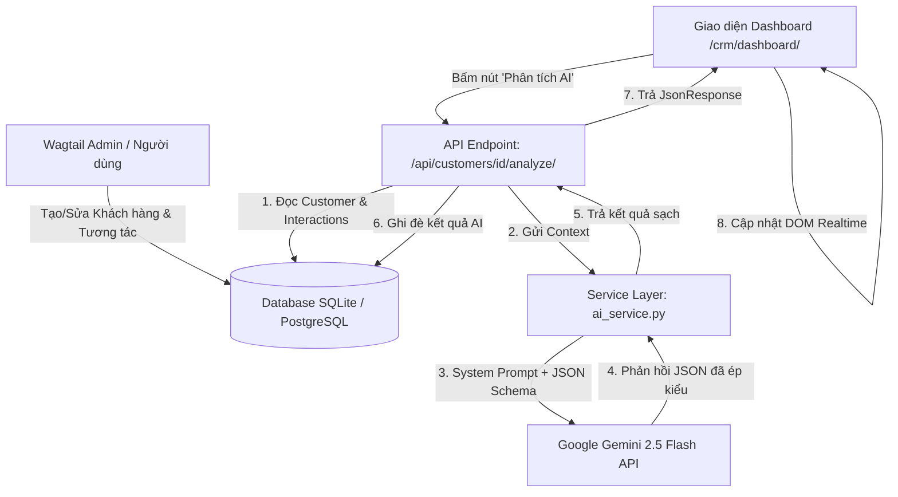

# 🚀 Mini-CRM Wagtail Tích Hợp AI (Google Gemini 2.5)

Hệ thống quản lý khách hàng thông minh (**AI-Powered Mini-CRM**) được xây dựng trên nền tảng **Django 5** & **Wagtail CMS 6**, tích hợp **Google GenAI SDK (Gemini API)** để tự động chấm điểm khách hàng tiềm năng (*Lead Scoring*), phân tích cảm xúc (*Sentiment Analysis*), đánh giá rủi ro rời bỏ (*Churn Risk*), tóm tắt lịch sử tương tác và đề xuất chiến lược tiếp cận.

---

## 📑 Mục Lục
- [1. Tổng Quan Hệ Thống & Kiến Trúc](#1-tổng-quan-hệ-thống--kiến-trúc)
- [2. Kiến Trúc Luồng Dữ Liệu](#2-kiến-trúc-luồng-dữ-liệu)
- [3. Ngăn Xếp Công Nghệ](#3-ngăn-xếp-công-nghệ)
- [4. Hướng Dẫn Cài Đặt Chi Tiết](#4-hướng-dẫn-cài-đặt-chi-tiết)
- [5. Kịch Bản Kiểm Thử Nhanh (Test Scenario)](#5-kịch-bản-kiểm-thử-nhanh-test-scenario)
- [6. Chạy Kiểm Thử Tự Động (Automated Tests)](#6-chạy-kiểm-thử-tự-động-automated-tests)

---

## 1. Tổng Quan Hệ Thống & Kiến Trúc

Hệ thống được chia thành 3 cấu phần cốt lõi:
1. **Quản trị Wagtail Admin**: Quản lý tập trung các thực thể `Customer`, `InteractionHistory`, `Order` thông qua `SnippetViewSetGroup` với bảng lọc, tìm kiếm và phân tách vùng dữ liệu AI riêng biệt (`MultiFieldPanel`).
2. **AI Service Layer (`crm_core.services.ai_service`)**: Sử dụng SDK `google-genai` mới nhất với mô hình `gemini-2.5-flash`. Áp dụng **Structured Outputs (Pydantic schema)** để ép kiểu JSON nghiêm ngặt và tích hợp cơ chế fallback an toàn khi gặp sự cố mạng hoặc quota.
3. **Internal Analytics Dashboard (`/crm/dashboard/`)**: Giao diện tối màu hiện đại bằng **Tailwind CSS**, hiển thị 4 KPI thống kê tổng hợp và bảng khách hàng thời gian thực với tính năng gọi AI AJAX không giật trang.

---

## 2. Kiến Trúc Luồng Dữ Liệu



---

## 3. Ngăn Xếp Công Nghệ

- **Backend Framework**: Python 3.11+, Django 5.2, Wagtail CMS 6.4
- **AI & LLM Integration**: Google GenAI SDK (`google-genai`), Model `gemini-2.5-flash`, Pydantic V2
- **Frontend & UI**: Tailwind CSS (Dark Mode), Vanilla JavaScript Fetch API, Google Fonts (Inter)
- **Database**: SQLite (Mặc định cho môi trường phát triển) / Hỗ trợ PostgreSQL

---

## 4. Hướng Dẫn Cài Đặt Chi Tiết

### Bước 1: Clone mã nguồn & Mở Terminal
Di chuyển vào thư mục gốc của dự án:
```powershell
cd "d:\individual\tlu document\business intelligence system\btap3\wagtail_ai_crm"
```

### Bước 2: Tạo và kích hoạt môi trường ảo (Virtual Environment)
```powershell
# Tạo môi trường ảo
python -m venv venv

# Kích hoạt môi trường ảo trên Windows PowerShell
.\venv\Scripts\activate
```

### Bước 3: Cài đặt các thư viện phụ thuộc
```powershell
pip install -r requirements.txt
```

### Bước 4: Cấu hình biến môi trường (`.env`)
Tạo hoặc mở file `.env` tại thư mục gốc và cấu hình API Key của bạn:
```env
# Django Configuration
DEBUG=True
DJANGO_SECRET_KEY=django-insecure-crm-ai-super-secret-key-2026

# Google Gemini API Key
# Lấy API Key miễn phí tại: https://aistudio.google.com/
GEMINI_API_KEY=AIzaSyYourActualGeminiAPIKeyHere
```

### Bước 5: Thực hiện Migrate Cơ sở dữ liệu
```powershell
python manage.py migrate
```

### Bước 6: Khởi tạo tài khoản Quản trị Wagtail (Superuser)
```powershell
python manage.py createsuperuser
# Nhập username, email, password theo hướng dẫn trên màn hình
```

### Bước 7: Nạp dữ liệu mẫu (Seed Data)
Chạy lệnh tạo sẵn 5 khách hàng, 9 lịch sử tương tác và 6 đơn hàng mẫu:
```powershell
python manage.py seed_crm_data
```

### Bước 8: Khởi chạy máy chủ phát triển
```powershell
python manage.py runserver
```
Hệ thống sẽ chạy tại địa chỉ: `http://127.0.0.1:8000/`

---

## 5. Kịch Bản Kiểm Thử Nhanh (Test Scenario)

Dành cho Giảng viên / Người đánh giá trải nghiệm hệ thống trong 2 phút:

### 🔹 Kịch bản 1: Trải nghiệm Dashboard AI Thời Gian Thực
1. Truy cập vào Dashboard: **`http://127.0.0.1:8000/crm/dashboard/`** (hoặc `http://127.0.0.1:8000/dashboard/`).
2. Quan sát **4 thẻ KPI thống kê** (Tổng khách, Điểm AI trung bình, Khách nguy cơ cao, Doanh số dự kiến).
3. Tìm dòng khách hàng **Pham Quang Huy** (đang có trạng thái `Điểm AI: --` và chưa có phân tích).
4. Bấm nút **[⚡ Phân tích AI]** ở cột cuối cùng:
   - Nút lập tức chuyển sang icon xoay vòng `Đang xử lý AI...` và bị khóa chống click đúp.
   - Sau 1-2 giây, các cột **Điểm AI**, **Badge Sắc thái (Sentiment)**, **Tóm tắt & Đề xuất AI**, **Churn Risk** tự động cập nhật giá trị mới với hiệu ứng màu sắc trực quan kèm thông báo Toast góc trên bên phải.

### 🔹 Kịch bản 2: Quản trị Wagtail Admin
1. Truy cập Wagtail Admin: **`http://127.0.0.1:8000/admin/`** và đăng nhập tài khoản superuser vừa tạo.
2. Trên thanh điều hướng bên trái, chọn mục **"Quản lý CRM"**:
   - **Khách hàng**: Xem danh sách, lọc theo trạng thái hoặc Churn Risk. Bấm vào một khách hàng để xem 2 khối panel riêng: *Thông Tin Khách Hàng* và *Phân Tích & Đề Xuất AI*.
   - **Lịch sử tương tác**: Xem nội dung trao đổi qua Email, Call, Meeting.
   - **Đơn hàng / Deal**: Xem danh sách giao dịch, số tiền và giai đoạn chốt.

---

## 6. Chạy Kiểm Thử Tự Động (Automated Tests)

Dự án có sẵn bộ test suite hoàn chỉnh gồm **6 bài test** bao phủ toàn bộ Models, Mock Gemini API (không tốn quota) và API View.

Chạy lệnh kiểm thử:
```powershell
python manage.py test crm_core.tests -v 2
```

### Kết quả mong đợi:
```text
test_analyze_customer_api_error_fallback (crm_core.tests.AIServiceTestCase.test_analyze_customer_api_error_fallback) ... ok
test_analyze_customer_success (crm_core.tests.AIServiceTestCase.test_analyze_customer_success) ... ok
test_trigger_customer_ai_analysis_endpoint (crm_core.tests.CustomerAIAnalysisEndpointTestCase.test_trigger_customer_ai_analysis_endpoint) ... ok
test_trigger_customer_ai_analysis_not_found (crm_core.tests.CustomerAIAnalysisEndpointTestCase.test_trigger_customer_ai_analysis_not_found) ... ok
test_customer_creation (crm_core.tests.CustomerModelTestCase.test_customer_creation) ... ok
test_interaction_history_creation (crm_core.tests.CustomerModelTestCase.test_interaction_history_creation) ... ok

----------------------------------------------------------------------
Ran 6 tests in 0.053s

OK
```
